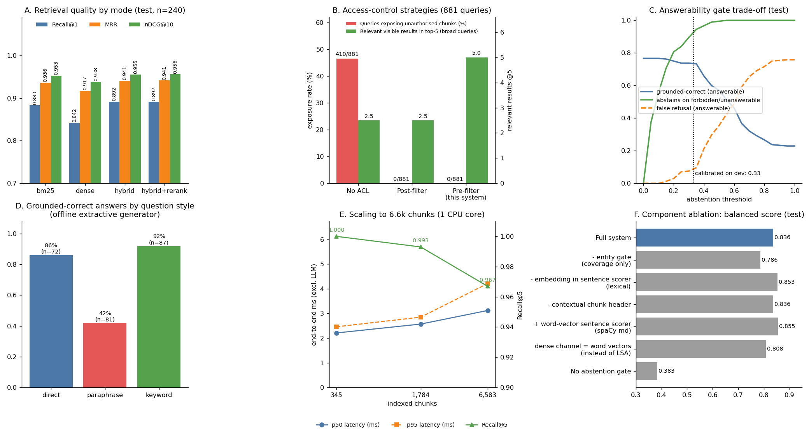
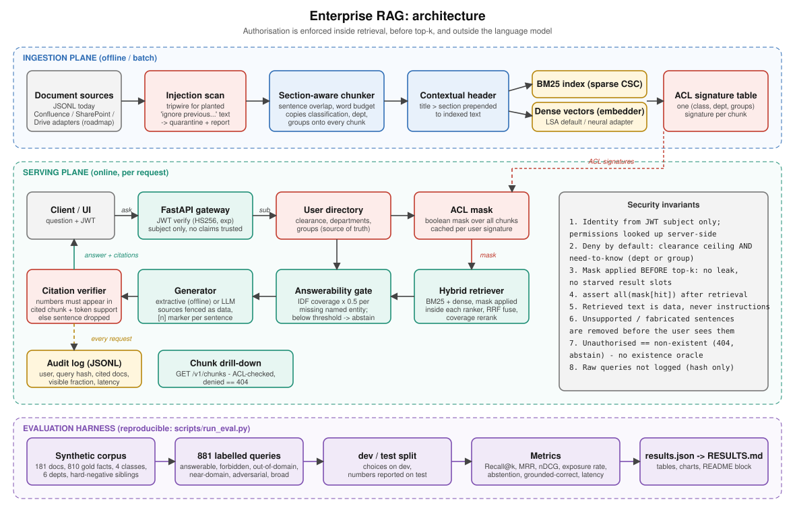

# Enterprise RAG

A document-based AI assistant for organisations where **not everyone may read everything**. It combines hybrid vector
search, per-sentence citations that are verified before the user sees them, an answerability gate that refuses instead of
guessing, access control enforced *inside* retrieval, and a reproducible evaluation harness with ground truth.

Everything below is measured by `scripts/run_eval.py`; nothing is hand-typed. See [How to read these numbers](#how-to-read-these-numbers)
before quoting any of them.

## Results at a glance

All numbers are on a **held-out test split**. Chunking and the abstention threshold were chosen on a separate dev split.

<!-- RESULTS:START -->
| Area | Metric | Result |
| --- | --- | --- |
| Retrieval | Recall@1 / Recall@5 / MRR (hybrid, test n=240) | **89.2%** / **100.0%** / **0.941** (MRR 95% CI 0.919-0.962) |
| Access control | Queries exposing an unauthorised chunk | **0 / 881** (no-ACL baseline: 410 / 881, 46.5%) |
| Access control | Relevant visible results in top-5 on under-specified queries | **5.0** pre-filter vs 2.5 post-filter |
| Access control | Adversarial / prompt-injection queries abstained | **100.0%** (15 queries; 0 unauthorised citations) |
| Answerability | Abstains on forbidden / non-existent-entity / out-of-domain | **94.7%** / **89.5%** / **91.7%** |
| Answers | Grounded-correct answers (offline extractive baseline, test n=240) | **73.3%** (false refusals 8.3%) |
| Citations | Cited chunk contains the gold fact (of answered) | **86.4%** |
| Citation verifier | Fabricated numbers / off-source claims blocked; clean sentences kept | **100.0%** / **97.5%**; 100.0% kept |
| Ingestion | Planted prompt-injection documents quarantined | **3 / 3** |
| Latency | End-to-end p50 / p95 (excl. LLM call), 345 chunks | **2.1 ms** / **2.7 ms**; p95 4.2 ms at 6,583 chunks |
<!-- RESULTS:END -->



Full tables, ablations and scaling data: [`docs/RESULTS.md`](docs/RESULTS.md).

## Architecture



Sequence diagram, access-decision flowchart, ingestion flow, the who-can-read-what matrix and the threat model are in
[`docs/architecture.md`](docs/architecture.md).

The one design decision that matters most: **authorisation is a boolean mask applied inside both rankers before top-k
selection**, derived from a server-side user directory. The language model never sees, and therefore can never leak,
a chunk the caller may not read. A prompt cannot widen access because access is not decided by a prompt.

## What is in the box

| Capability | Implementation |
|---|---|
| Ingestion | Section-aware chunker with sentence overlap; ACL metadata copied to every chunk; contextual header (title + section); prompt-injection tripwire with quarantine |
| Vector search | BM25 (sparse CSC matrix) + dense vectors, fused with Reciprocal Rank Fusion, then an IDF-coverage reranker. Pluggable `Embedder` (LSA offline default, spaCy word-vector and sentence-transformers adapters) |
| Access control | Clearance levels (PUBLIC < INTERNAL < CONFIDENTIAL < RESTRICTED) + need-to-know by department or explicit group. Deny by default. Masks cached per user signature |
| Citations | `[n]` marker per sentence, mapped to doc / chunk / section / quoted span. A verifier drops any sentence whose numbers or key terms are absent from the cited chunk |
| Abstention | Confidence = IDF query coverage × 0.5 per named entity missing from the retrieved context. Threshold calibrated on dev |
| Generation | `ExtractiveGenerator` (offline, deterministic) and `AnthropicGenerator` (LLM, sources fenced as untrusted data). Both pass through the same verifier |
| Service | FastAPI: `POST /v1/ask`, `GET /v1/chunks` (ACL-checked drill-down, denied = 404), JWT auth, JSONL audit log (query hashed) |
| Evaluation | Synthetic corpus with gold facts, 881 labelled queries in 6 populations, bootstrap CIs, ablations, scale benchmark, verifier fuzzing |
| Tests | 27 tests including security regression tests; verified to fail when the ACL check or the verifier is deliberately broken |

## Quickstart

```bash
pip install -r requirements.txt
make test                       # 27 tests
make eval && make report        # regenerate every number, chart and the table above (~1 min, CPU only)
make demo                       # same question asked by four users with different access

export ERAG_JWT_SECRET=$(python -c "import secrets; print(secrets.token_urlsafe(32))")
make serve &
TOKEN=$(PYTHONPATH=src python -m erag.cli token erin)
curl -s localhost:8000/v1/ask -H "Authorization: Bearer $TOKEN" -H 'content-type: application/json' \
     -d '{"question": "How many days notice is required to terminate the Zentara Systems agreement?"}'
```

```json
{"answer": "Either party must give 60 days written notice to terminate the Zentara Systems agreement. [1]",
 "abstained": false,
 "citations": [{"n": 1, "doc_id": "leg-vendor-0", "chunk_id": "leg-vendor-0#0",
                "title": "Vendor Agreement Summary: Zentara Systems", "section": "Overview / Commercials / Termination",
                "quote": "Either party must give 60 days written notice to terminate the Zentara Systems agreement."}]}
```

The same request with a token for `henry` (general employee) or `grace` (contractor) returns
`"abstained": true` with no citations, and the response is indistinguishable from asking about a vendor that does not exist.

Use an LLM for generation (not benchmarked here, see limitations):

```python
from erag.generation import AnthropicGenerator      # pip install anthropic; export ANTHROPIC_API_KEY=...
pipe = RAGPipeline(chunks, generator=AnthropicGenerator())   # model via ERAG_LLM_MODEL
```

## Evaluation methodology

* **Corpus.** 181 synthetic documents (178 after quarantine) across Finance, HR, Security, Legal, Engineering, Sales and a public FAQ, in four
  classifications. Real corporate data cannot be shared and an evaluation needs known answers, so every document is generated
  from templates that embed one-sentence *facts*; each question has an exact gold sentence, value and document.
* **Hard negatives.** Sibling documents differ only by an entity: 16 incident runbooks that vary by severity × product, 18 compensation bands by family × level,
  40 vendor agreements, 40 service runbooks. A wrong-sibling answer is the realistic failure, and it is what the entity gate and the same-chunk rule exist to stop.
* **Question styles.** Each fact has three phrasings: *direct*, *paraphrase* (synonyms the document never uses: "lodging" for hotel, "outage" for incident) and *keyword* (search-box style).
* **Six populations.** `answerable` (user may read the gold doc; must answer correctly with a citation), `forbidden` (user may not; must abstain),
  `unanswerable_generic` (out of domain), `unanswerable_near` (right template, entity does not exist, e.g. a vendor that is not in the corpus),
  `adversarial` (15 "ignore your rules" prompts from low-privilege users) and `broad` (under-specified queries that match many documents, used to compare ACL strategies).
* **Metrics.** Retrieval: Recall@k, MRR, nDCG@10 at chunk and document level, bootstrap 95% CIs. *Grounded-correct* = the answer contains the gold value **and** cites a chunk that contains the gold sentence.
  Security: share of queries where any returned or cited chunk is unreadable by the caller.
* **No test-set tuning.** Even/odd split. Chunking, and the abstention threshold, were chosen on dev. Each ablation variant gets its own threshold re-calibrated on dev.

## Findings, including the ones that did not work

1. **Access control by construction.** Zero of 881 queries exposed an unreadable chunk, including all adversarial ones. The identical index without the mask exposed 410 of 881 (46.5%),
   and every forbidden query surfaced its gold document (300 / 300).
2. **Post-filtering is also leak-free but gives worse context.** On under-specified queries ("How long is the on-call rotation?") the post-filter strategy returned 2.5 usable results out of 5 and under-filled every such query; the pre-filter returned 5.0 and never under-filled.
   On well-specified queries the two strategies tied (both Recall@5 = 1.0), which is why a benchmark made only of precise questions cannot tell them apart.
3. **The entity gate is the largest single gain in abstention quality.** Coverage alone abstained on only 47% of questions about non-existent entities; adding the entity check raised that to 89.5% and the balanced score from 0.786 to 0.836.
   Cost: 8.3% false refusals on answerable questions. Without any gate the system answers 100% of unanswerable and forbidden questions, with a sibling document's content.
4. **Hybrid retrieval did not beat BM25 here.** Hybrid MRR 0.941 vs BM25 0.936 with overlapping confidence intervals (0.919-0.962 vs 0.913-0.958); dense-only was lowest on Recall@1 (0.842).
   Queries are entity-heavy, which is the regime where lexical search excels. A static word-vector embedder as the dense channel was *worse* than the LSA default (balanced 0.808 vs 0.836) because it cannot represent rare entity names.
5. **Retrieval metrics saturate on a small corpus.** Recall@5 is 100% at 181 documents and drops to 96.7% at 3,301 documents (6,583 chunks), the first sign of the hard-negative pressure a real corpus applies. Treat Recall@5 here as a smoke test; Recall@1 and MRR carry the signal.
6. **Chunking: whole-document chunks win retrieval and lose end-to-end.** With documents averaging 112 words, "pack 160w" is one chunk per document (MRR 0.992 on dev) but the lowest end-to-end accuracy (0.812 vs 0.854), so selection used end-to-end accuracy, not retrieval MRR.
7. **A bug the benchmark under-reported, found by running the demo.** Asking for "Engineering L5" salary also quoted "Operations L5" (a different number) because supporting sentences could come from sibling chunks. Fixed (supporting sentences must come from the same chunk as the best one), covered by a regression test, and the full evaluation was re-run.
   The headline grounded-correct rate went *down* (77.5% → 73.3%) because the earlier metric had been rewarding answers that hedged across siblings.
8. **No measurable effect** from the contextual chunk header or from an embedding-based sentence scorer on this corpus (all variants within about 4 pp on n = 240, where the standard error is about 2.8 pp).

## How to read these numbers

* **The corpus is synthetic and template-generated.** It is built to test *mechanisms* (access control, abstention, citation checking) where ground truth is exact. It does not predict absolute accuracy on your documents. Re-run the harness on a labelled sample of your own corpus before drawing any conclusion about quality.
* **The negative sets were authored by the same person who built the entity gate.** The 89.5% near-domain abstention is likely optimistic for entity styles the heuristic does not model.
* **The offline extractive generator is weak on paraphrased questions: 42% grounded-correct vs 86% (direct) and 92% (keyword).** Choosing a fact sentence when the question shares no vocabulary with it ("how much do we pay X per year" vs "annual contract value") needs semantic understanding.
  The `AnthropicGenerator` path exists, is unit-tested with a stub (it cannot produce an unverified sentence), and is the intended remedy, but **it has not been benchmarked**: the build environment had no API key. That gap is the first thing to close.
* **Latency excludes any network LLM call** and was measured on one CPU core with an in-memory index (p50 about 2 ms and p95 about 3 ms at 345 chunks, p95 about 4 ms at 6,583 chunks; exact values move by about 1 ms between runs, see the table above). In production, generation latency will dominate.
* **The default embedder is LSA, not a neural encoder**, so that the project runs offline and reproducibly. Swap in `SentenceTransformerEmbedder` and re-run `make eval`.
* **The verifier fuzz test is simulated**, not measured on real LLM output: it mutates gold sentences (fabricated number) or cites an unrelated sentence (off-source claim).

## Project layout

```
src/erag/
  models.py        Document, Chunk, User, Citation, Answer
  access.py        can_read policy, AccessMask (per-user boolean masks), UserDirectory
  ingest.py        section-aware chunking, injection quarantine
  retrieval.py     BM25, embedders, hybrid retriever (RRF + coverage rerank)
  gate.py          answerability: IDF coverage x entity check
  generation.py    extractive + Anthropic generators, citation verifier
  pipeline.py      authorise -> retrieve -> gate -> generate -> verify -> audit
  api.py           FastAPI service (JWT, ask, chunk drill-down)
  audit.py         append-only JSONL audit log
  synth.py         synthetic corpus with ground-truth facts
  evalsets.py      six labelled query populations
  evaluation.py    metrics runners, ACL strategy comparison, verifier fuzz, scale benchmark
scripts/           run_eval.py, make_report.py, make_diagram.py
tests/             27 tests (policy, ingestion, pipeline, verifier, API)
docs/              architecture.md / .svg, RESULTS.md, results.png
data/              generated corpus, users, labelled queries
```

## Taking this to production

1. Replace the offline embedder with a neural encoder and add a cross-encoder reranker; re-run the harness.
2. Benchmark the LLM generator on a labelled sample of real documents, and keep the verifier in front of it.
3. Move the in-memory matrices to an ANN store that supports pre-filtering (pgvector, Qdrant, OpenSearch) and keep the same signature-to-mask contract.
4. Connect real sources (SharePoint, Confluence, Drive) and sync ACLs from the identity provider; add a metadata-only path for permission changes.
5. OIDC or asymmetric JWTs, rate limiting at the gateway, per-tenant indexes if tenants must not share corpus statistics.
6. Feed thumbs-up / thumbs-down and abstention outcomes back into the evaluation set.

The Dockerfile is provided but was not built in the authoring environment.
