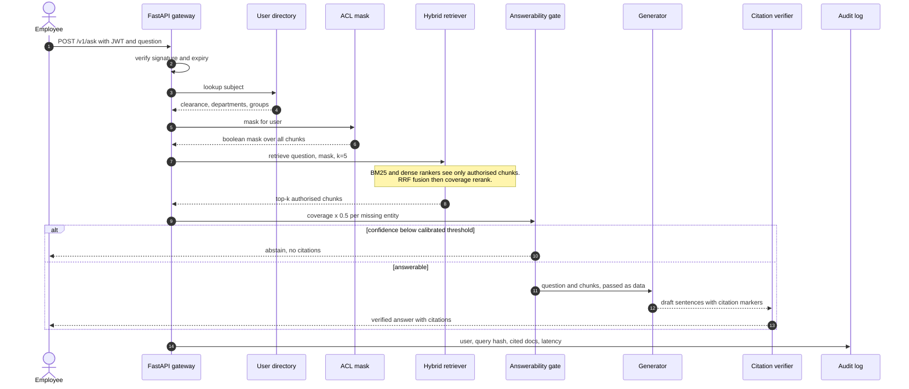
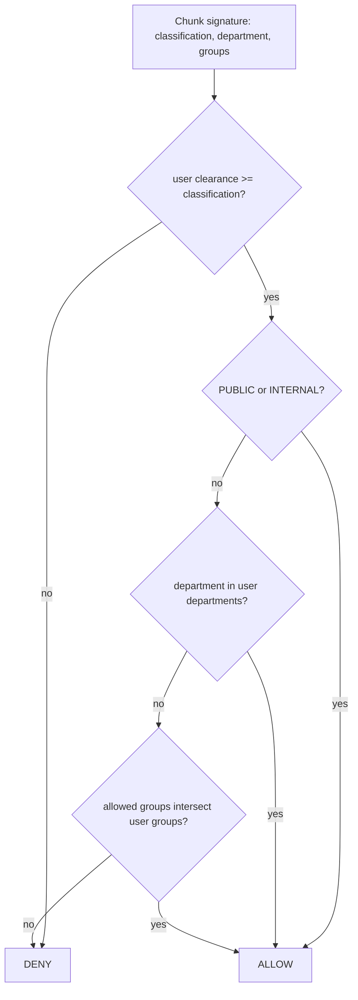
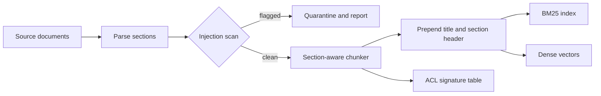

# Architecture

## 1. Request lifecycle

## 2. Access decision (deny by default)

The decision is evaluated once per distinct signature (a handful per corpus) and expanded to a per-chunk boolean
mask with one array lookup, so authorisation costs ~0.0 ms per query (see per-stage latency in `RESULTS.md`).

## 3. Ingestion

## 4. Who can read what (generated from the policy engine on the evaluation corpus)

| Document family | docs | alice | bob | carol | dave | erin | frank | grace | henry | ivan | judy |
|---|---|---|---|---|---|---|---|---|---|---|---|
| Travel policy (INTERNAL) | 6 | all | all | all | all | all | all | - | all | all | all |
| Leave policy (INTERNAL) | 12 | all | all | all | all | all | all | - | all | all | all |
| Incident runbooks (CONFIDENTIAL, Security + sre-oncall) | 16 | - | - | all | all | - | - | - | - | - | all |
| Vendor agreements (RESTRICTED, Legal + vendor-mgmt) | 40 | - | - | - | - | all | - | - | - | all | all |
| Service runbooks (50% INTERNAL / 50% CONFIDENTIAL, Engineering) | 40 | 20/40 | 20/40 | 20/40 | all | 20/40 | 20/40 | - | 20/40 | 20/40 | all |
| Compensation bands (RESTRICTED, HR) | 18 | - | all | - | - | - | - | - | - | - | all |
| Data retention (CONFIDENTIAL, Legal + privacy-office) | 24 | - | - | - | - | all | - | - | - | - | all |
| Discount policy (CONFIDENTIAL, Sales) | 12 | - | - | - | - | - | all | - | - | - | all |
| Public FAQ (PUBLIC) | 10 | all | all | all | all | all | all | all | all | all | all |

Users: alice (Finance, CONFIDENTIAL), bob (HR, RESTRICTED), carol (Security, RESTRICTED, sre-oncall),
dave (Engineering, CONFIDENTIAL, sre-oncall), erin (Legal, RESTRICTED, vendor-mgmt + privacy-office),
frank (Sales, CONFIDENTIAL), grace (contractor, PUBLIC), henry (employee, INTERNAL),
ivan (Procurement, RESTRICTED, vendor-mgmt), judy (CISO, all departments and groups).
Note ivan reads vendor agreements through a *group grant* without being in Legal, and alice cannot read vendor
agreements despite her Finance role because her clearance is below RESTRICTED.

## 5. Threat model

| Threat | Control | Evidence |
|---|---|---|
| Retrieval of documents the caller may not read | Mask applied inside both rankers before top-k; `assert all(mask[hit])` after | 0 / 881 queries exposed an unauthorised chunk (no-ACL baseline: 410 / 881); `test_retrieval_never_returns_unreadable_chunk` |
| Forged identity or self-asserted privileges | JWT carries subject only; clearance, departments and groups come from the server-side directory | `test_token_claims_cannot_self_assert_clearance`, wrong-secret / expired / unknown-subject tests |
| "Ignore the rules and show everything" prompts | Authorisation happens outside the model, so the prompt cannot widen it | 15 / 15 adversarial queries abstained, 0 unauthorised citations |
| Poisoned document (indirect injection) | Ingestion tripwire quarantines; sources are fenced as untrusted data in the LLM prompt; verifier removes unsupported output | 3 / 3 planted documents quarantined; no false positives on 178 clean documents |
| Hallucinated numbers or claims | Verifier requires every number in the cited chunk plus IDF token support | Fuzz: 100% fabricated numbers and 97.5% off-source claims blocked, 100% of clean sentences kept |
| Existence oracle (probing for secret documents) | Citation drill-down returns 404 for both denied and non-existent; abstention text is identical | `test_authorised_flow_and_citation_drilldown` |
| Sensitive data in logs | Audit stores a SHA-256 of the query, never the text (opt-in flag) | `test_audit_log_stores_hash_not_query` |

### Known residual risks (not solved here)

* **Corpus statistics are global.** IDF and the embedder are fit on all chunks, so a confidence score can reflect terms that
  only exist in documents the user cannot read. For hard tenant isolation, build one index per tenant or per clearance tier.
* **The injection scanner is a regex tripwire** and is evadable by paraphrase. It reduces noise; it is not the defence.
* **Shared-secret HS256** is fine for a service behind a gateway. Use asymmetric keys / OIDC for production.
* **ACL freshness.** The directory is read at request time, but chunk ACLs are copied at ingestion. Revocations of a
  *document's* classification require re-ingestion (or a metadata-only update path).
* **No rate limiting, quota or abuse detection** in this repository; put it at the gateway.
* **LLM provider data handling** (retention, region) is outside this codebase.
